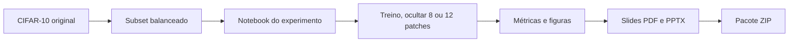

# 02. Anatomia do repositório

O fluxo lembra uma oficina. Primeiro, os dados passam por seleção. Depois, o notebook conduz o teste e os scripts preparam os materiais finais. Em paralelo, o estudo de retreinamento segue outro caminho, com regras congeladas. Cada etapa tem arquivos próprios.

## Mapa do fluxo

O diagrama mostra o caminho principal, desde o conjunto de imagens até o pacote de entrega. A parte de treino usa o notebook e o modelo descritos nos capítulos seguintes.

## Mapa de pastas

| Caminho | Papel em linguagem simples |
|---|---|
| `README.md` | Manual principal: explica o experimento, a instalação e os comandos. |
| `pyproject.toml` e `uv.lock` | Receita do ambiente Python e versões de programas usados. |
| `codigo/notebook.ipynb` | Roteiro executável do experimento, do preparo dos dados até as figuras. |
| `codigo/mae.py` | Modelo que separa a imagem em partes e prevê as partes escondidas. |
| `codigo/dados.py` | Baixa e verifica o CIFAR-10, escolhe as imagens e salva o subconjunto. |
| `codigo/treino.py` | Confere a GPU, treina o modelo e calcula a medida no teste. |
| `codigo/preparar_dados.py` | Entrada de linha de comando para baixar os dados e criar o subconjunto. |
| `codigo/configuracao_estudo.py` | Regras congeladas do estudo de retreinamento: candidatos, limites e orçamento. |
| `codigo/estudo_*.py` | Módulos do estudo: máscaras, candidatos, orçamento, histórico, seleção, SSIM e avaliação. |
| `scripts/construir_notebook.py` | Fonte única usada para gerar o notebook executável. |
| `scripts/gerar_slides.py` | Produz os arquivos editáveis e de leitura da apresentação. |
| `scripts/montar_zip.py` | Confere os arquivos obrigatórios e monta o pacote compactado. |
| `scripts/gerar_relatorio_fase_b.py` | Gera o relatório interno a partir dos registros do estudo. |
| `dados/cifar10_subset/` | Índices das imagens escolhidas e imagens salvas em formato compacto. |
| `resultados/` | Medidas e figuras do experimento registrado no repositório. |
| `resultados/estudo-melhorar-reconstrucoes-mae/` | Registros da rodada v1 do estudo: manifesto, histórico, contador, resumo, figuras e ficha visual. |
| `resultados/estudo-melhorar-reconstrucoes-mae-c0-v2/` | Registros da rodada v2, isolada, que retomou somente o candidato C0. |
| `slides/` | Apresentação e imagens complementares usadas nos slides. |
| `docs/` | Guia explicativo do repositório e planejamento do seminário em DOCX e Markdown. |
| `tests/` | Verificações automáticas do modelo, dos dados, do pacote e da comparação com a referência. |
| `openspec/specs/` | Regras detalhadas sobre o comportamento esperado do experimento e dos materiais. |
| `openspec/changes/archive/` | Histórico das mudanças já concluídas, com propostas, decisões e relatórios. |
| `.github/workflows/` | Configuração para executar testes automaticamente no GitHub. |

## Peças com analogia

- **A prancheta:** `codigo/notebook.ipynb`, reúne as etapas em ordem e mostra os resultados.
- **A recepção e a balança:** `codigo/dados.py`, obtém as imagens e confere o arquivo antes de usá-lo.
- **O reconstrutor:** `codigo/mae.py`, lê as partes visíveis e prevê os pixels faltantes.
- **O treinador:** `codigo/treino.py`, ajusta o modelo e mede o erro ao longo do processo.
- **O regulamento do estudo:** `codigo/configuracao_estudo.py`, guarda as regras que valem para todos os candidatos, com hash que prova que não mudaram no meio do caminho.
- **O contador de tempo:** `codigo/estudo_orcamento.py`, soma o tempo gasto e recusa começar uma atividade nova sem saldo.
- **O arquivista:** `codigo/estudo_historico.py`, escreve uma linha por época e por evento, sem apagar nada.
- **O juiz:** `codigo/estudo_selecao.py`, aplica a regra congelada para escolher ou não um vencedor.
- **A pasta de evidências:** `resultados/`, guarda os números e as figuras produzidos.
- **A equipe de apresentação:** `scripts/gerar_slides.py` prepara os slides; `scripts/montar_zip.py` confere e reúne os arquivos.

## Ambiente e dependências

O projeto usa Python 3.12 ou superior, PyTorch, Torchvision, NumPy, pandas, Matplotlib e Jupyter. O arquivo `uv.lock` registra as versões resolvidas para tornar a instalação mais consistente.

O índice configurado para PyTorch usa a família CUDA 13.0. A GPU é requisito do treino, não uma opção aceleradora: sem ela, a execução para. O executor do estudo repete a exigência e recusa CUDA com versão principal menor que 13.

`vit-pytorch` e `pytest` ficam no grupo de desenvolvimento. O primeiro serve como referência automatizada para comparar o modelo próprio. Ele não é importado durante o treino normal e não entra no ZIP de entrega.

## Atenção ao planejamento

O arquivo em `docs/` se apresenta como planejamento e diz que não é a apresentação pronta. Como o repositório também contém o notebook, os resultados e os slides gerados, tratar esse planejamento como manual de execução atual seria arriscado. *(inferência)* Para comandos e comportamento, o README e o código oferecem evidência mais direta.

## Registro do estudo

As regras detalhadas do estudo ficam em `openspec/specs/melhorias-reconstrucao/spec.md`. Os materiais do estudo concluído estão em `openspec/changes/archive/2026-10-15-melhorar-reconstrucoes-mae/`, e as medições agregadas ficam em `resultados/estudo-melhorar-reconstrucoes-mae/`. Cada pasta cumpre um papel: requisitos descrevem o comportamento esperado; resultados guardam os números medidos.
