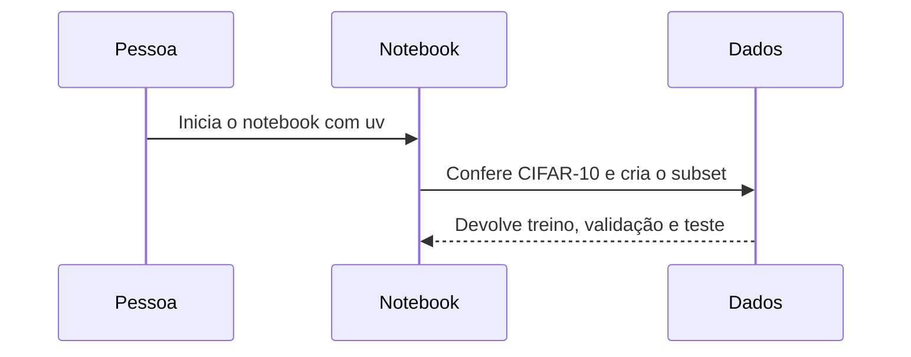
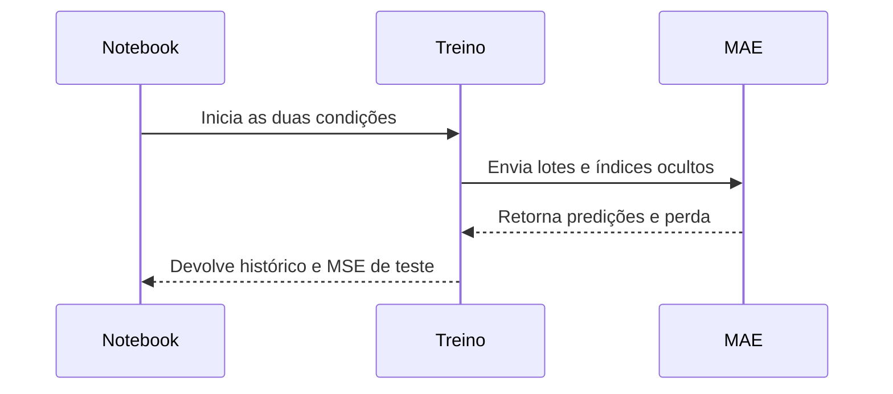

# 03. Jornada de uma execução

A execução principal passa pelo notebook. Ele prepara os dados, treina duas versões do modelo e salva os resultados usados pelos slides.

## Preparação dos dados

Este diagrama mostra a conversa entre a pessoa que inicia o notebook e a parte que prepara os dados. Antes do treino, o notebook também verifica se há uma GPU CUDA disponível.



O arquivo original é baixado pelo Torchvision quando ainda não existe. O código confere o MD5 esperado antes de selecionar imagens. Uma falha nessa conferência interrompe a preparação.

## Treinamento do modelo

O segundo diagrama acompanha o ciclo de treino. A implementação recebe os lotes de imagens, oculta as posições definidas e devolve a previsão e o erro.



## Do início ao pacote

1. **Preparar o ambiente.** Para usar o pacote sem testes, o README documenta `uv sync --no-dev`. Para desenvolvimento e testes, documenta `uv sync`.
2. **Obter os dados.** `codigo/preparar_dados.py` baixa o CIFAR-10, verifica seu MD5 e grava o subconjunto balanceado. O notebook também contém a preparação dos dados.
3. **Separar as imagens.** São escolhidas 500 imagens por classe para treino, 100 para validação e 100 para teste. A seleção usa a semente 42.
4. **Treinar duas condições.** A primeira esconde 8 dos 16 quadrados da imagem. A segunda esconde 12. As duas usam AdamW e o mesmo orçamento de treino.
5. **Medir no teste.** Depois de treinar, o código calcula o MSE nas partes escondidas do conjunto de teste. Essa medida não participa da escolha do treino.
6. **Guardar evidências.** O notebook grava `resultados/metricas.csv`, `curva_perda.png`, `reconstrucoes.png` e pesos em `checkpoints/`. Os pesos não entram no ZIP.
7. **Preparar a apresentação.** `scripts/gerar_slides.py` usa os números do CSV e os recursos visuais para gerar PPTX, PDF e imagens PNG de inspeção. `scripts/montar_zip.py` confere a lista de arquivos e grava o ZIP com um registro de MD5.

Antes do treino final, o notebook mede uma época três vezes. Usa o menor tempo para escolher de 60 a 200 épocas. No CSV atual, foram registradas 200 épocas para cada condição.

## Comandos documentados

A sequência de recuperação descrita no README é:

```sh
uv sync --no-dev
uv run --no-dev python codigo/preparar_dados.py --seed 42
uv run --no-dev jupyter nbconvert --execute --to notebook --inplace codigo/notebook.ipynb
uv run --no-dev python scripts/gerar_slides.py
uv run --no-dev python scripts/montar_zip.py
```

Para desenvolvimento, o README também documenta `uv run pytest` e `uv run python scripts/construir_notebook.py`.

A geração dos slides depende do LibreOffice, chamado como `soffice`, e do `pdftoppm`, parte do Poppler. O script informa erro se um deles faltar.

## O que os comandos alteram

Esses comandos gravam ou substituem o subconjunto de dados, a saída do notebook, as figuras, a apresentação, o ZIP e o registro de MD5. A execução do notebook também cria `checkpoints/`. É prudente usar uma cópia de trabalho e preservar os resultados que precisem ser mantidos.

Os comandos acima foram transcritos das instruções do repositório e conferidos nos arquivos correspondentes. Não foram executados durante esta documentação.
