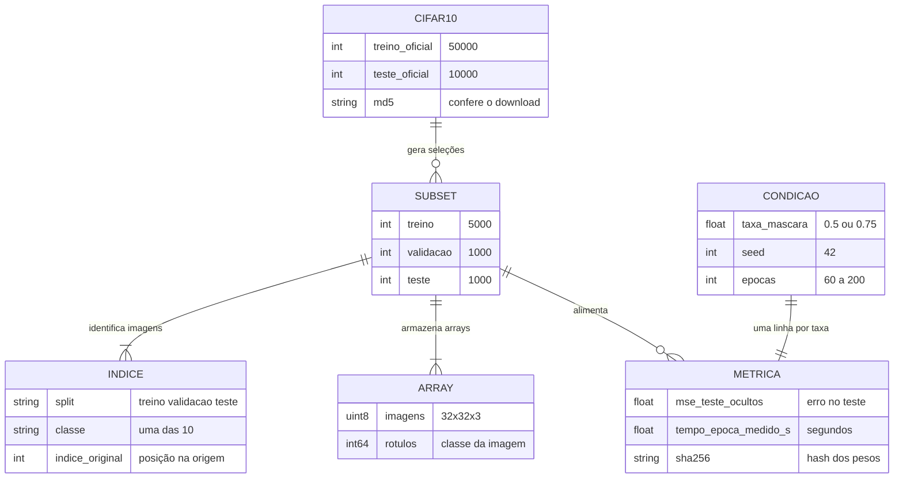

# 04. Dados e resultados

O projeto usa arquivos locais, não um banco de dados. O diagrama abaixo resume como o conjunto original, a seleção, as imagens e as medidas se relacionam.

## Mapa dos dados

As caixas representam arquivos ou coleções de registros. As ligações indicam de onde os dados vêm e o que alimentam, não tabelas de um banco de dados.

## Conjunto original e seleção

O CIFAR-10 oficial contém 60.000 imagens coloridas de 32 por 32 pixels, divididas em 10 classes. O arquivo original traz 50.000 imagens de treino e 10.000 de teste.

O projeto cria uma seleção balanceada por classe:

| Parte | Imagens por classe | Total | De onde vêm |
|---|---:|---:|---|
| Treino | 500 | 5.000 | Partição oficial de treino |
| Validação | 100 | 1.000 | Partição oficial de treino, sem repetir as imagens de treino |
| Teste | 100 | 1.000 | Partição oficial de teste |

A validação acompanha o treino durante o ajuste. O conjunto de teste é reservado para a medição final.

## Arquivos de dados

### `dados/cifar10_subset/indices.csv`

Cada linha identifica uma imagem escolhida. O arquivo tem três colunas:

| Coluna | Significado |
|---|---|
| `split` | Diz se a imagem pertence a `treino`, `validacao` ou `teste`. |
| `classe` | Nome da classe da imagem, como `gato` ou `navio`. |
| `indice_original` | Posição da imagem na partição original do CIFAR-10. |

### `dados/cifar10_subset/subset.npz`

O arquivo compactado contém seis conjuntos de números. As imagens são armazenadas como inteiros de 8 bits, formato que ocupa menos espaço.

| Chave | Formato conferido | Conteúdo |
|---|---|---|
| `treino` | `(5000, 32, 32, 3)`, uint8 | Imagens de treino |
| `treino_rotulos` | `(5000,)`, int64 | Classes das imagens de treino |
| `validacao` | `(1000, 32, 32, 3)`, uint8 | Imagens de validação |
| `validacao_rotulos` | `(1000,)`, int64 | Classes das imagens de validação |
| `teste` | `(1000, 32, 32, 3)`, uint8 | Imagens de teste |
| `teste_rotulos` | `(1000,)`, int64 | Classes das imagens de teste |

Os rótulos ajudam a selecionar e conferir as classes. A função de treino usa os pixels, não as classes, para calcular o erro de reconstrução.

## Medidas do experimento

`resultados/metricas.csv` tem uma linha por condição de mascaramento. As colunas principais registram:

| Coluna | O que significa |
|---|---|
| `condição` | Nome da condição, máscara de 50% ou 75%. |
| `mse_teste_ocultos` | Erro médio quadrático nos pixels das partes escondidas do teste. |
| `épocas`, `batch`, `lr` | Número de passagens de treino, tamanho do lote e velocidade de ajuste. |
| `tempo_epoca_medido_s` | Tempo medido para uma época, em segundos. |
| `orcamento_previsto_min` | Duração prevista registrada para o experimento. |
| `sha256` | Identificador calculado a partir dos pesos salvos do modelo. |
| `python`, `pytorch`, `cuda`, `driver`, `gpu` | Versões e equipamento usados na medição. |
| `seed` | Semente usada para escolhas aleatórias, registrada como 42. |

Na cópia examinada, os valores são:

| Condição | MSE do teste nos patches ocultos |
|---|---:|
| Máscara de 50% | 0,06084 |
| Máscara de 75% | 0,07168 |

O menor valor indica menor diferença de reconstrução nesta medida e neste teste. A especificação do projeto proíbe tratar essa diferença como tendência geral ou como prova de melhor desempenho em outras tarefas.

Os pesos do modelo ficam em `checkpoints/` quando o notebook é executado. O README informa que eles ficam fora do ZIP. O CSV guarda o SHA-256 de cada arquivo de pesos para permitir conferência.

## Recursos complementares dos slides

As imagens em `slides/recursos-complementares/` vêm de um experimento separado com um MAE pré-treinado público. O README e os slides identificam esse material como complementar, não como resultado gerado pelo treinamento deste repositório.
