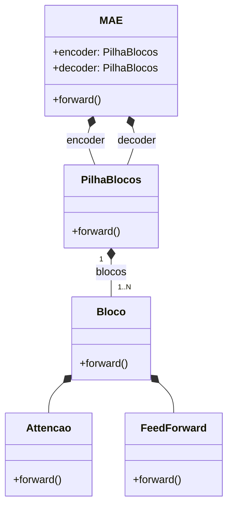

# 05. Componentes principais

O modelo é montado como uma pilha de blocos: cada bloco combina atenção e uma etapa de processamento. O diagrama mostra apenas as classes que compõem o modelo.

## Partes internas do MAE

A relação de composição indica que o componente de cima é montado com as partes ligadas abaixo. A implementação tem uma pilha para o encoder e outra para o decoder.

O encoder tem dimensão 128, quatro blocos e quatro cabeças de atenção, com dimensão interna de 32 por cabeça. Ele processa apenas os patches visíveis. O decoder tem dimensão 64, dois blocos e quatro cabeças, com dimensão interna de 64 por cabeça. Ele prevê 192 valores de pixel para cada patch de 8 por 8 em uma imagem com três canais de cor.

A máscara é aninhada: a ordem dos 16 quadrados é fixada por imagem com a semente 42, e ocultar 12 quadrados inclui sempre os 8 quadrados ocultos pela condição de 50%.

## Quem faz o quê

| Peça | Analogia | Função verificada no código | Onde fica |
|---|---|---|---|
| `MAE` | Reconstrutor principal | Junta as partes, codifica os pedaços visíveis, coloca marcadores nos lugares escondidos e prevê pixels. | `codigo/mae.py` |
| `patchify` e `unpatchify` | Cortador e montador | Convertem imagens em quadrados de 8 por 8 e fazem o caminho inverso. | `codigo/mae.py` |
| `permutacoes_fixas` | Sorteio repetível | Define a ordem dos 16 quadrados com semente 42. | `codigo/mae.py` |
| `indices_ocultos` | Régua de posição | Traduz a taxa de máscara em quantos quadrados ficam escondidos. | `codigo/mae.py` |
| `perda_mae` | Régua de comparação | Calcula o MSE somente nos quadrados escondidos. | `codigo/mae.py` |
| `reconstrucao_completa` e `imagem_com_buracos` | Montagem de demonstração | Preparam reconstruções e imagens com partes cobertas para as figuras. | `codigo/mae.py` |
| `codigo.dados` | Recepção e conferência | Baixa o CIFAR-10, verifica o MD5, seleciona e salva imagens. | `codigo/dados.py` |
| `codigo.treino` | Treinador e avaliador | Exige GPU CUDA, treina com AdamW, mede o tempo e avalia o conjunto de teste. | `codigo/treino.py` |
| Notebook | Roteiro de laboratório | Executa as etapas na ordem e grava CSV, figuras e pesos. | `codigo/notebook.ipynb` |
| Gerador de notebook | Molde do roteiro | Gera `codigo/notebook.ipynb` a partir de uma única fonte. | `scripts/construir_notebook.py` |
| Gerador de slides | Montador da apresentação | Lê resultados e imagens, cria PPTX, PDF e PNG para inspeção. | `scripts/gerar_slides.py` |
| Montador do ZIP | Conferente de entrega | Verifica arquivos obrigatórios, grava o ZIP e registra o MD5 de cada arquivo. | `scripts/montar_zip.py` |
| Regras do estudo | Regulamento | Declara candidatos, limites, parâmetros de SSIM e orçamento, com hash. | `codigo/configuracao_estudo.py` |
| Máscaras do estudo | Sorteio estável | Gera a máscara de cada imagem a partir da identidade, da época e da semente. | `codigo/estudo_mascaras.py` |
| Candidatos do estudo | Fábrica controlada | Monta as variantes C0, C1, C2 e C3 e suas funções de erro. | `codigo/estudo_candidatos.py` |
| Orçamento do estudo | Contador de tempo | Soma o consumo e recusa iniciar atividade sem saldo previsto. | `codigo/estudo_orcamento.py` |
| Histórico do estudo | Arquivista | Escreve uma linha por evento e deriva o resumo. | `codigo/estudo_historico.py` |
| Seleção do estudo | Juiz | Aplica a regra de ganho contra C0 e declara vencedor ou ausência de ganho. | `codigo/estudo_selecao.py` |
| Avaliação do estudo | Régua fixa | Mede MSE e SSIM na mesma máscara, somente nos patches ocultos. | `codigo/estudo_avaliacao.py` e `codigo/estudo_ssim.py` |
| Controles do estudo | Referências sem rede | Preenchem os ocultos com média RGB e interpolação dos visíveis. | `codigo/estudo_baselines.py` |
| Ficha visual | Inspeção humana | Escolhe oito IDs por hash e prepara a ficha de notas. | `codigo/estudo_visual.py` |

## Testes e conferência automática

A pasta `tests/` tem 17 arquivos de teste. Além das regras de dados, do modelo, da montagem do ZIP e da comparação com a classe MAE de `vit-pytorch`, a suíte cobre cada módulo do estudo: máscaras, candidatos, checkpoints, histórico, orçamento, seleção, avaliação, baselines e ficha visual.

Na comparação com o oráculo, os dois modelos recebem pesos e máscaras iguais. O teste verifica formatos, erro e reconstrução dentro de tolerâncias definidas no próprio teste. O relatório fica em `tests/relatorio_equivalencia.txt`.

O `vit-pytorch` é uma referência de teste, não uma peça usada no treino normal. Ele fica no grupo de desenvolvimento e fora do pacote ZIP.

O fluxo `.github/workflows/tests.yml` roda os testes em três situações: mudança na branch principal, solicitação de integração ou execução manual. Instala as versões fixadas com `uv sync --locked` e roda `uv run pytest -q`. Isso descreve a configuração, não o resultado de uma execução específica.

Há ainda um fluxo de revisão automática em `.github/workflows/mira-push-review.yml` e outro em `.github/workflows/mira-review.yml`. A configuração fica em `.mira.yaml`.

## Saídas e dependências externas

- `resultados/metricas.csv`: medidas e versões do ambiente.
- `resultados/curva_perda.png`: mudança do erro de validação ao longo das épocas.
- `resultados/reconstrucoes.png`: imagens originais, cobertas e reconstruídas.
- `checkpoints/`: pesos salvos pelo notebook, fora do ZIP.
- `slides/*.pptx` e `slides/*.pdf`: apresentação editável e versão de leitura.
- `slides/*.png`: imagens das páginas para inspeção visual.
- `seminario_masked_modeling.zip`: pacote de entrega, fora do controle de versão.

Para regenerar PDF e imagens de inspeção, o script de slides chama LibreOffice (`soffice`) e `pdftoppm`. Essas ferramentas são instaladas fora do ambiente Python.
