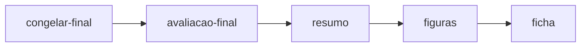
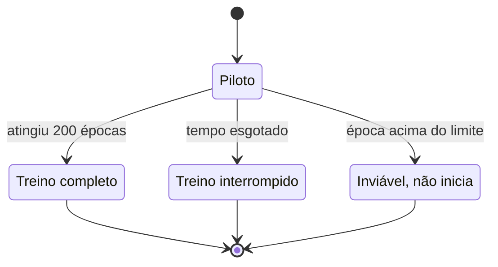

# 06. Estudo de retreinamento

Este capítulo cobre a segunda parte do repositório: um estudo que testa se mudanças de arquitetura e de função de erro melhoram as reconstruções do MAE. O nome do estudo é `melhorar-reconstrucoes-mae` e seus registros ficam em `resultados/estudo-melhorar-reconstrucoes-mae/`.

## Por que um estudo separado

O experimento original usa uma única semente e não compara variantes de treino. Para saber se uma mudança ajuda, o estudo congela as regras antes de treinar, mede tudo na mesma régua e registra o tempo gasto. A intenção declarada é medir ganhos reais e, acima disso, relatar com clareza quando eles não acontecem.

## O caminho do estudo

O caminho tem doze subcomandos. Para não virar uma linha única, o fluxo está dividido em duas fases. Cada subcomando é retomável: repetir um já concluído não reinicia o trabalho.

A primeira fase vai do congelamento das regras ao término dos treinos.

A segunda fase fecha a seleção e produz os documentos.

Congelar grava o arquivo de regras e seu hash. O piloto mede uma época por taxa e marca o candidato como inviável se ela passar do limite de 1,2 s. O treino consome o saldo do orçamento e para no limite. Os controles preenchem os patches ocultos sem rede. A decisão de C3 só ocorre se a referência C0 vencer todos os controles nas duas taxas e sobrar saldo. A seleção aplica a regra de ganho. O congelamento final fecha as regras antes de qualquer consulta ao conjunto de teste. A avaliação final consulta o teste uma única vez.

## Os candidatos

| Nome | O que muda | Justificativa registrada |
|---|---|---|
| C0 | Nada, é o MAE direto retreinado | Referência do protocolo novo, isola o efeito das máscaras por identidade, época e semente |
| C1 | Decoder de dimensão 128 e três blocos | Mais capacidade de decodificação pode ajudar com poucos patches visíveis, em especial a 75% |
| C2 | Perda MSE mais 0,1 de L1 | L1 pode reduzir borramento; o MSE nos ocultos continua sendo a medida comparável |
| C3 | Residual sobre a média RGB dos visíveis | Só executa se C0 vencer cada controle nas duas taxas e sobrar saldo |

Todos os candidatos mantêm a entrada, a resolução, a quantidade de patches e a codificação dos visíveis do MAE em `codigo/mae.py`.

Fora dos candidatos, dois controles sem rede preenchem os patches ocultos somente a partir dos visíveis: a média de cor dos pixels visíveis e a interpolação espacial pelos centros dos patches visíveis. Existem ainda caminhos de reserva explícitos, que nunca consultam pixels ocultos.

## O que foi congelado antes de treinar

- Três sementes de treino: 10, 20 e 30. A semente fixa os sorteios usados pelo treino; ela ajuda a repetir uma execução, mas não garante resultados idênticos entre versões do PyTorch ou plataformas diferentes.
- Duas taxas de máscara: 50% e 75%, aninhadas.
- Até 200 épocas por execução de semente e taxa.
- Lote de 64, AdamW com taxa de aprendizado 0,0001, decaimento de peso 0,05.
- Limiar de ganho: razão de MSE de 0,95 contra C0 e ganho de 0,02 no SSIM mediano, em cada taxa.
- Tolerância de desempate no SSIM de 0,01.
- Orçamento total de 120 minutos: 90 minutos principais e 30 de reserva, nunca excedido.
- Envelope de 30 minutos por candidato, com piloto de 2 minutos, 4 minutos por execução de semente e taxa, 2 de consolidação e 2 de avaliação.
- Oito IDs de inspeção visual escolhidos por hash antes de qualquer inferência.

As regras ficam em `codigo/configuracao_estudo.py` e o hash da serialização canônica identifica a versão. Qualquer divergência faz a verificação falhar.

## O que aconteceu na rodada v1

O candidato C0 não passou do piloto. A época piloto a 50% levou 1,2215 s, acima do limite de 1,2 s. Com C0 inviável, nenhum dos seis treinos de C0 começou, e o saldo do candidato não foi redistribuído.

C1 e C2 passaram do piloto e treinaram com três sementes e duas taxas. Cinco execuções terminaram com 200 épocas. Uma, C1 com semente 10 a 75%, foi interrompida pelo limite de tempo e terminou com 185 épocas.

Como a referência C0 não existia, a regra de ganho contra C0 não pôde ser aplicada nas duas taxas. A seleção registrou zero candidatos elegíveis e nenhum vencedor nas duas taxas. A decisão de C3 ficou como não executada, com 42,9653 minutos livres e o motivo registrado: o critério de média de MSE de C0 contra cada controle não era verificável. A avaliação final foi feita somente com os controles, já que nenhum candidato tinha elegibilidade.

O tempo consumido ficou em 41,0615 minutos na alocação principal, com a reserva intocada.

## Estados das execuções

O diagrama mostra os três estados possíveis de uma execução de semente e taxa e o que leva de um para outro.

## O que aconteceu na rodada v2

Uma autorização posterior permitiu retomar somente o C0, com regras próprias e sem tocar nos registros da v1. A rodada v2 alterou um único parâmetro: o limite do piloto passou para 1,25 s. Ela usa pasta própria, manifesto próprio e contador de reserva separado, limitado a 30 minutos e sujeito ao teto global somado à v1.

Os dois pilotos de C0 falharam: 1,4305 s a 50% e 1,3583 s a 75%. Nenhum dos seis treinos começou. O consumo da v2 foi de 0,209334139 minuto e o total de v1 e v2 ficou em 41,270848124 minutos.

## Referências de validação

Os controles abaixo servem como comparação descritiva. O MSE e o SSIM foram calculados sobre o conjunto de validação, não sobre o teste.

| Taxa | Controle | MSE | SSIM |
|---|---|---:|---:|
| 50% | Média RGB dos visíveis | 0,049111 | 0,355596 |
| 50% | Interpolação espacial | 0,044741 | 0,269084 |
| 75% | Média RGB dos visíveis | 0,051706 | 0,355630 |
| 75% | Interpolação espacial | 0,054458 | 0,237844 |

Na validação, C1 a 75% teve SSIM mediano 0,362957, contra 0,355630 da média RGB. C2 a 50% teve 0,365044, contra 0,355596. As diferenças são menores que o ganho mínimo de 0,02 previsto nas regras. Cada controle é uma referência determinística, não três repetições independentes. Os valores por semente e a consolidação constam em `resultados/estudo-melhorar-reconstrucoes-mae/resumo.json`.

## A avaliação visual humana

A ficha visual foi preparada para oito IDs escolhidos por hash, nas duas taxas, com notas de cor, estrutura, borramento e artefatos de 1 a 5 e preferência pareada. O registro original não contém notas.

Depois, uma avaliação visual aberta de um único avaliador considerou os resultados ruins nas duas taxas e concluiu que o objetivo visual não foi atingido. Não houve avaliação cega e não foram atribuídas notas individuais. Esse julgamento qualitativo não altera a seleção numérica e não mede qualidade de representações.

## Como ler o resultado

O resultado do protocolo é inconclusivo: C0 não completou o piloto, então a regra de ganho contra a referência não pôde ser aplicada e nenhum vencedor foi declarado. Isso não equivale a uma derrota dos demais candidatos. As comparações numéricas são exploratórias, sem confirmação independente nem demonstração de superioridade geral. Separadamente, a avaliação visual aberta foi negativa nas duas taxas. O conjunto de teste foi consultado uma única vez, depois do congelamento da seleção.

## Onde conferir

- Regras congeladas: `codigo/configuracao_estudo.py` e `codigo/configuracao_estudo_c0_v2.py`.
- Requisitos do estudo: `openspec/specs/melhorias-reconstrucao/spec.md`.
- Resumo da v1: `resultados/estudo-melhorar-reconstrucoes-mae/resumo.json`.
- Resumo da v2: `resultados/estudo-melhorar-reconstrucoes-mae-c0-v2/resumo.json`.
- Relatório da fase B: `openspec/changes/archive/2026-10-15-melhorar-reconstrucoes-mae/relatorio-fase-b.md`.
- Notas de fechamento do estudo: `openspec/changes/archive/2026-10-15-melhorar-reconstrucoes-mae/notas-finais.md`.
